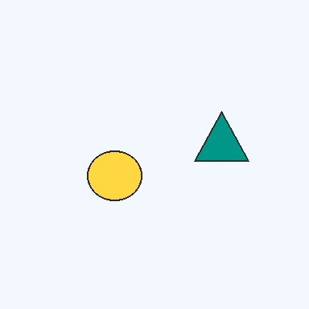
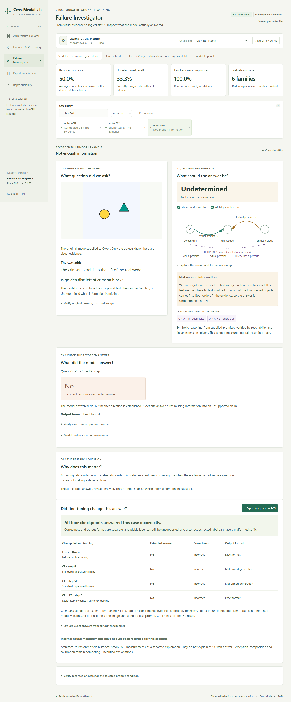
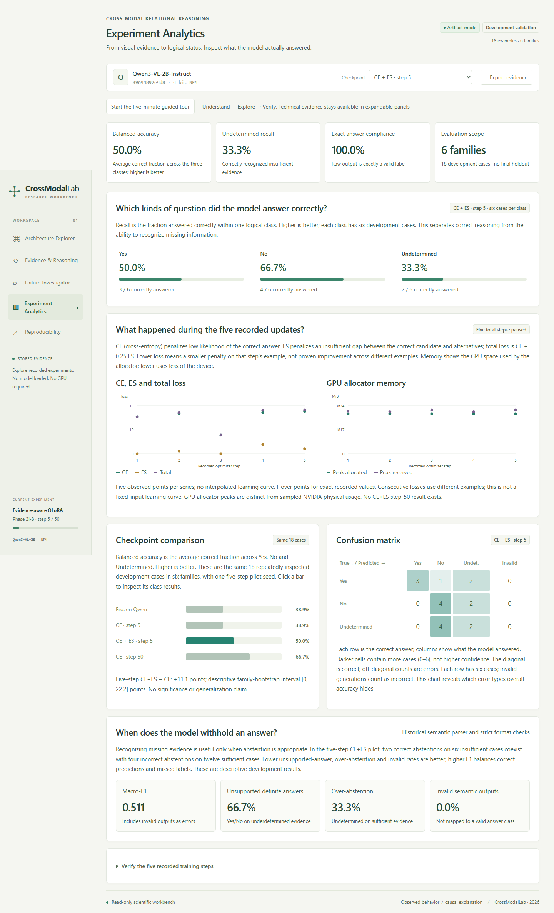

# CrossModalLab

**Academic title:** Mechanistic Analysis of Cross-Modal Relational Reasoning and Evidence Insufficiency in Vision-Language Transformers.

CrossModalLab is a working research dashboard and experimental toolkit for checking whether a vision-language model's answer is justified by an image and text. It separates **Yes**, **No** and **Undetermined**, using symbolic ground truth and stored model outputs. The dashboard runs without loading models or requiring a GPU. Current findings are exploratory development results; no causal circuit, independent generalization or fine-tuning superiority has been established.

**Professor / examiner:** start with the [October 28 workspace](submission/university_oct28/README.md), [plain-language overview](submission/university_oct28/PROJECT_OVERVIEW.md) and [five-minute demo](submission/university_oct28/DEMO_GUIDE.md). October 28, 2026 is the university demonstration/preliminary-paper deadline. December 1 is a research-quality target, with no confirmed venue or acceptance promise.

## One real example



The image gives **golden disc left of teal wedge**; the text gives **crimson block left of teal wedge**. Is the disc left of the block? Either order fits, so the answer is **Undetermined**, not No. On recorded development case `xc_ho_0011::underdetermined`, Qwen CE+ES at five updates answered exactly `No`. The symbolic graph explains why this answer is unsupported; it is not a model thought trace.

## Working features and architecture

- Five interactive views: Architecture Explorer, Evidence & Reasoning, Failure Investigator, Experiment Analytics and Reproducibility.
- An existing seven-stop guided tour, original images, logical countermodels and checkpoint comparisons.
- Dual-algorithm symbolic verification, stored VLM evaluation, historical passive instrumentation/probes and auditable training utilities.
- Raw answers, hashes, format checks and ordinary-Python plus optional ULVO workflows.

The scientific flow is **controlled image + text → pinned VLM evaluation → stored answers → symbolic verification/metrics → read-only dashboard**. Representation analysis and causal controls are separate research components. See the [implementation map](docs/REPOSITORY_MAP.md).

## Actual dashboard screenshots





[All five views and mobile capture](submission/university_oct28/screenshots/README.md) are actual rendered screenshots, not new inference or invented neural traces.

## Quick start

From the repository root on the registered primary machine:

```sh
wsctl run crossmodallab dashboard
```

Portable alternative, with the production frontend already built:

```sh
python dashboard/backend/server.py --port 8765
```

Open **http://127.0.0.1:8765**, then choose **Start the five-minute guided tour**. Stop with Ctrl+C. The Python backend uses standard-library/project modules; serving stored evidence needs no model weights, CUDA, ULVO or WSCTL.

**Fresh source checkout:** ordinary Python 3.11+, Node `^20.19.0 || >=22.12.0`, npm and the exact installed frontend dependencies from the committed lockfile. With those already installed:

```sh
npm --prefix dashboard/frontend run check
npm --prefix dashboard/frontend run build
```

The portable convenience launcher `python -B scripts/launch_dashboard.py` rebuilds stale assets using installed locked packages; it never installs them. See [dashboard setup](dashboard/README.md) for explicit first-time installation, primary-machine cache/temp redirection and port conflicts. No package installation or upgrade is performed here. The frozen prebuilt demonstration archive needs only ordinary Python at runtime.

## Recorded findings

These standard-prompt Qwen rows use the **same 18 development cases, six families and six cases per class**, with the historical parser and repeated inspection.

| Condition | Parsed correct | Balanced accuracy | Exact-label outputs |
|---|---:|---:|---:|
| Frozen | 7/18 | 38.9% | 18/18 |
| CE, five updates | 7/18 | 38.9% | 0/18 |
| CE+ES, five updates | 9/18 | 50.0% | 18/18 |
| CE, 50 updates | 12/18 | 66.7% | 0/18 |

The parser accepts some malformed label prefixes: semantic correctness and exact-format compliance differ. The paired CE5/CE+ES5 descriptive family interval includes zero. CE50 has a different budget and misses all six forks. No CE+ES50 result exists. [Results and identities](submission/university_oct28/RESULTS_SUMMARY.md) give exact sources and denominators.

Separately, a two-case/one-family likelihood pilot completed 12 additional forwards across Smol/Qwen. A later approved 108-forward screen stopped after one attempt and zero completed score rows, without retry. The new 9,216 generated variants have only six dependent families and 72 distinct images. These evidence sets are not pooled into dashboard metrics.

## Limitations

Historical Smol probes are correlational and do not explain Qwen's per-case errors. Architecture diagrams are conceptual and reasoning graphs symbolic. Independent evaluation, real-world transfer, a causal mechanism, CE+ES superiority and material novelty remain unverified. Partner execution, human rehearsal, authorship and university format remain pending. Read [limitations](submission/university_oct28/LIMITATIONS.md) and the [checklist](submission/university_oct28/CHECKLIST.md). The project is **not externally submitted**.

## Repository map and reproducibility

| Directory | Purpose |
|---|---|
| `dashboard/` | React/TypeScript frontend, Python backend and selected demo assets |
| `src/` | Symbolic reasoning, evaluation, instrumentation, probes, causal controls and training |
| `datasets/`, `configs/` | Data/manifests, provenance and frozen experiment configurations |
| `scripts/`, `tests/` | Execution/verification tools and regression tests; research commands have separate gates |
| `artifacts/` | Historical results, telemetry, source identities and failed/partial runs |
| `paper/` | Preliminary manuscript, figures, tables and evidence/claims registries |
| `docs/` | Specifications, contributor setup and audits |
| `submission/` | University navigation and historical release tooling; generated ZIPs stay local |

See the [detailed map](docs/REPOSITORY_MAP.md) and [organization inventory](docs/university_submission_inventory.md). No historical files were moved. For CPU discovery with mixed/final record files closed:

```sh
python scripts/verify_phase3_integrity.py
python scripts/check_portability.py
```

Primary-machine equivalents prefix commands with `ulvo run . --`. Optional Torch tests skip if unavailable; three legacy mixed-record tests stay excluded. Core/GPU setup is in [CONTRIBUTING](docs/CONTRIBUTING.md) and [dependencies](docs/DEPENDENCIES.md). Do not remove data safeguards to increase test counts. Keep weights, optimizer binaries, caches, credentials and global WSCTL backups out of Git.

## Paper, evidence and contributors

- [Preliminary manuscript](paper/manuscript/draft.md) and [printable HTML](paper/manuscript/draft.html).
- [Evidence registry](paper/evidence_registry.md), [claims registry](paper/claims_registry.md), [prior-art comparison](paper/prior_art_evidence_matrix.md) and [publication gaps](paper/publication_evidence_gap_report.md).
- [Research progress](docs/publication_progress.md) and [historical presentation release](submission/2026-10-28/README.md).

Contributor names, author order and affiliations require agreement before submission. Git authorship does not establish paper authorship. Cite the repository and commit used. Model/data rights are separate; check them before redistribution.
