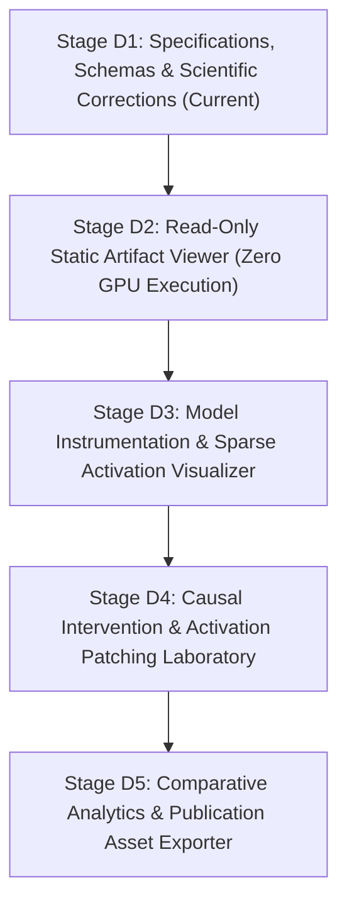

# Staged Implementation Roadmap: Transformer Research Laboratory Dashboard

**Document ID:** `ROADMAP-0001`  
**Phase:** Phase D1 (Roadmap & Stage Governance)  
**Status:** Living Standard  

---

## 1. Governance Principles & Transition Invariants

To maintain scientific integrity, computational safety, and strict alignment with laboratory hardware constraints:
1. **Incremental Staging:** Development is strictly serialized into five stages (D1 through D5). No stage may commence until the preceding stage has passed all verification criteria.
2. **Offline-First Before GPU Execution:** The dashboard UI is fully implemented and tested as a read-only artifact viewer (Stage D2) before live GPU model instrumentation is introduced (Stage D3).
3. **Hardware-Gated VRAM Profiling:** Candidate models (`SmolVLM-500M-Instruct` primary, `SmolVLM-2B` secondary) must undergo empirical memory profiling before hook attachments are integrated into the dashboard backend.
4. **Drive C: Quarantine:** Zero writes, caches, or virtual environments on drive `C:`. All development resides within `E:\Workspace\Active\CrossModalLab`.

---

## 2. Stage Breakdown & Acceptance Criteria

### Stage D1: Scientific Corrections & Dashboard Specification (Current Stage)
* **Goal:** Correct all scientific defects in Phase 0A foundation documents and establish formal dashboard specifications and schemas.
* **Deliverables:**
  - Updated [`AGENTS.md`](file:///E:/Workspace/Active/CrossModalLab/AGENTS.md), [`README.md`](file:///E:/Workspace/Active/CrossModalLab/README.md), [`docs/research_spec.md`](file:///E:/Workspace/Active/CrossModalLab/docs/research_spec.md), [`docs/literature_review.md`](file:///E:/Workspace/Active/CrossModalLab/docs/literature_review.md), [`docs/novelty_matrix.md`](file:///E:/Workspace/Active/CrossModalLab/docs/novelty_matrix.md), [`docs/experiment_protocol.md`](file:///E:/Workspace/Active/CrossModalLab/docs/experiment_protocol.md), [`docs/mechanistic_methods.md`](file:///E:/Workspace/Active/CrossModalLab/docs/mechanistic_methods.md), and [`docs/decisions/0001-research-foundation.md`](file:///E:/Workspace/Active/CrossModalLab/docs/decisions/0001-research-foundation.md).
  - New [`docs/dashboard_spec.md`](file:///E:/Workspace/Active/CrossModalLab/docs/dashboard_spec.md), [`docs/artifact_schemas.md`](file:///E:/Workspace/Active/CrossModalLab/docs/artifact_schemas.md), and [`docs/dashboard_roadmap.md`](file:///E:/Workspace/Active/CrossModalLab/docs/dashboard_roadmap.md).
* **Acceptance Criteria:**
  - Zero placeholder links (`id=xxx`, `.xxx`, dummy DOIs).
  - All arbitrary thresholds (`>95%`, `<80%`) removed and replaced with formal 4-tier statistical decision rules.
  - Probe decodability $\neq$ causal usage and probe failure $\neq$ feature absence explicitly enforced.
  - Activation patching causal non-uniqueness explicitly documented.
  - Zero code implementations or dependency installations.

---

### Stage D2: Read-Only Static Artifact Viewer
* **Goal:** Implement the local-first web UI consuming pre-computed static JSONL and Safetensors experiment artifacts without requiring PyTorch or GPU memory.
* **Key Tasks:**
  - Initialize React + Vite + TypeScript frontend in `dashboard/frontend/`.
  - Install core UI packages: `reactflow` (DAG navigation), `react-plotly.js` + `plotly.js-dist-min` (scientific plots), `@tanstack/react-query` (data fetching), and Tailwind CSS.
  - Implement FastAPI backend in `dashboard/backend/` reading static files via Pydantic v2 schemas.
  - Implement the 6 dashboard module screens using static demo artifacts (`is_synthetic_demo: true`).
* **Acceptance Criteria & Tests:**
  - Automated Schema Test: All test artifacts validate against Pydantic schemas with 100% pass rate.
  - Rendering Benchmark: UI renders a 4,000-sample dataset index and interactive React Flow DAG with zero UI jank ($> 55\text{ FPS}$).
  - Benchmark Immutability Test: Backend returns `405 Method Not Allowed` on any write request to dataset or run paths.
  - Demo Quarantine Test: UI displays `[SYNTHETIC DEMO]` banner on all mock data.

---

### Stage D3: Model Instrumentation & Sparse Activation Visualizer
* **Goal:** Integrate live forward-pass hooking with candidate compact VLMs (SmolVLM-500M) under batch size 1 and sparse layer caching.
* **Key Tasks:**
  - Implement `BaseActivationAdapter` with `HuggingFaceDecoderLayerAdapter` and `SiglipVisionEncoderAdapter`.
  - Implement layer-selective forward hook extraction: activations detached, cast to float16, and stored in host RAM or memory-mapped Safetensors on drive `E:`.
  - Wire Architecture Explorer and Failure Investigator to display real forward-pass activations and diagnostic probe evaluations.
* **Acceptance Criteria & Tests:**
  - Memory Ceiling Test: Full forward pass with active hooks on SmolVLM-500M consumes $< 2.5\text{ GB}$ VRAM on the RTX 2050 (verified via `torch.cuda.max_memory_allocated()`).
  - OOM Safety Test: Triggering simulated OOM is caught gracefully, clears CUDA cache, and returns a clean API error without crashing the server.
  - Adapter Test: Hook adapters correctly extract hidden states from both tuple and dataclass module returns.

---

### Stage D4: Causal Intervention Laboratory
* **Goal:** Implement the interactive activation patching and counterfactual intervention engine.
* **Key Tasks:**
  - Implement asynchronous GPU worker (`dashboard/backend/runner.py`) using `asyncio.create_subprocess_exec`.
  - Build the interactive patching grid in Plotly.js: clicking layer/head cells dispatches an activation patching run.
  - Implement automated negative controls: shuffled activations and Gaussian noise injection.
  - Implement cancellation endpoints (`POST /api/jobs/{id}/cancel`) sending SIGTERM to worker processes.
* **Acceptance Criteria & Tests:**
  - Intervention Accuracy Test: Patched runs correctly compute Normalized Indirect Effect (NIE) and delta logits.
  - Control Validation Test: Negative controls (shuffled noise) produce near-zero NIE, confirming absence of non-specific disruption.
  - Cancellation Test: Canceling an in-flight patching job terminates the subprocess and resets VRAM allocation within 2.0 seconds.

---

### Stage D5: Comparative Multi-Model Analytics & Publication Figure Exporter
* **Goal:** Support cross-model side-by-side comparison (e.g. SmolVLM-500M vs. SmolVLM-2B) and one-click publication-ready figure exports.
* **Key Tasks:**
  - Multi-run diffing view comparing layer trajectories, calibration curves, and error category distributions.
  - Vector SVG and 300 DPI PDF export module with embedded cryptographic provenance footers (Git commit SHA, model weights hash, dataset SHA-256).
* **Acceptance Criteria & Tests:**
  - Export Verification: Exported SVGs render cleanly in vector graphics editors (Inkscape/Illustrator) with all text as vector paths.
  - Provenance Audit: Every exported figure metadata block matches the source run artifact SHA-256 hash.
