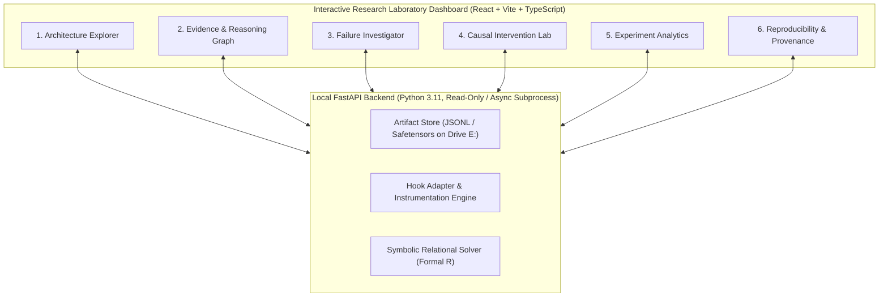

# Scientific Specification: Interactive Transformer Research Laboratory Dashboard

**Document ID:** `DASH-SPEC-0001`  
**Phase:** Phase D1 (Dashboard Specification & Foundation)  
**Status:** Living Specification  

---

## 1. Executive Summary & Design Philosophy

The **Transformer Research Laboratory Dashboard** is an interactive, local-first scientific workbench designed for mechanistic interpretability of compact vision-language Transformers (VLMs). It provides researcher-facing tools to inspect internal hidden states, evaluate formal logical topologies, trace diagnostic probe trajectories, and execute causal activation interventions.

### Foundational Scientific Principles
1. **No Conflation of Correlation and Causality:** Probes and attention weights are visualized strictly as *correlational diagnostic indicators*. The dashboard explicitly forbids labeling any component as the "unique failure locus" without causal intervention evidence.
2. **Explicit Separation of Ground Truth and Neural Computation:** The interface renders the symbolically verified logical deduction strictly separate from the model's observed activation states.
3. **No Fabricated "Model Thoughts":** The dashboard never claims to reconstruct a model's "literal reasoning trace" or "thought process". All displays reflect measured mathematical quantities: attention weights, hidden state projections, and token log-likelihoods.
4. **4 GB VRAM & Offline-First Execution:** Designed to operate on an NVIDIA RTX 2050 Laptop GPU (4 GB VRAM) under Windows 11, consuming versioned, immutable JSONL and Safetensors experiment artifacts on drive `E:`.

---

## 2. Core Dashboard Modules



---

### Module 1: Architecture Explorer
* **Purpose:** Multi-scale hierarchical exploration of the target vision-language model, from top-level macro DAG down to individual attention heads and residual stream dimensions.
* **Component Views (React Flow + Plotly.js):**
  - **Macro DAG View:** Interactive graph displaying Vision Encoder (e.g., SigLIP), Multimodal Connector (MLP Projector), Transformer Decoder Layers ($L_0 \dots L_{N-1}$), and Final Unembedding Head.
  - **Layer Drilldown View:** Clicking any layer node expands its internal sub-blocks:
    - Multi-Head Attention: Query ($W_Q$), Key ($W_K$), Value ($W_V$), and Output ($W_O$) projections.
    - MLP Block: Gate ($W_{\text{gate}}$), Up ($W_{\text{up}}$), and Down ($W_{\text{down}}$) projections with $\text{SiLU}$ non-linearity.
    - Residual Stream Bus: Visualizes additive residual accumulation $h_l = h_{l-1} + \Delta h_{\text{attn}} + \Delta h_{\text{mlp}}$.
  - **Token Position Selector:** Slider navigating across visual prefix tokens ($T_{\text{vis}}$), text premise tokens ($T_{\text{premise}}$), query tokens ($T_{\text{query}}$), and generation position ($T_{\text{gen}}$).
  - **Neuron & Feature Inspection:**
    - Explicitly separates:
      - *Individual Neuron:* Scalar activation $a_{l, i} = \text{SiLU}((W_{\text{gate}} x)_i)$.
      - *Activation Dimension:* Basis coordinate $j$ in the residual stream $h_l \in \mathbb{R}^{d_{\text{model}}}$.
      - *Sparse Learned Feature:* Latent feature $f_k$ extracted via Sparse Autoencoders (SAEs), if loaded.
      - *Causal Circuit:* Verified subgraphs of heads/layers.
* **Educational Explanations:** Collapsible mathematical cards displaying exact operations:
  $$\text{Attention}(Q, K, V) = \text{Softmax}\left(\frac{Q K^T}{\sqrt{d_k}}\right) V$$
  $$\text{MLP}(x) = W_{\text{down}} (\text{SiLU}(W_{\text{gate}} x) \odot W_{\text{up}} x)$$
* **Scientific Warning Banner:** `⚠️ ATTENTION MAPS ARE CORRELATIONAL ROUTING DISTRIBUTIONS, NOT CAUSAL EXPLANATIONS`.

---

### Module 2: Evidence and Reasoning Graph
* **Purpose:** Render the formal relational problem structure side-by-side with measured internal activations.
* **Symbolic Ground Truth Engine:**
  - Evaluates premises over strict directional relation $R(x, y)$ ($\text{left-of}$) satisfying irreflexivity, asymmetry, transitivity, and strict 1D total order:
    - **Forward Chain:** $R(A, B) \land R(B, C) \implies R(A, C)$ (**Entailed $\top$**).
    - **Reverse Chain:** $R(B, A) \land R(C, B) \implies R(C, A) \implies \neg R(A, C)$ (**Contradicted $\bot$**).
    - **Underdetermined Fork:** $R(A, B) \land R(C, B) \not\models R(A, C)$ and $\not\models \neg R(A, C)$ (**Underdetermined $?$**).
  - Fork Resolution Visualizer: Renders the two competing linear extensions ($A \prec C \prec B$ vs. $C \prec A \prec B$) to visually demonstrate why positive and negative conclusions are equally unsupported.
* **Dual-Panel Display:**
  - *Left Panel:* Pure symbolic DAG generated by the formal logic solver.
  - *Right Panel:* Measured neural computation graph. Edges indicate linear probe decodability margins and attention allocation across multimodal premises.
* **Persistent Header:** `LEFT: SYMBOLIC GROUND TRUTH (FORMAL LOGIC) | RIGHT: MEASURED MODEL ACTIVATIONS (EMPIRICAL)`.

---

### Module 3: Failure Investigator
* **Purpose:** Isolate the computational locus and nature of reasoning errors on individual evaluated samples.
* **Prediction & Logit Analysis:**
  - Multi-token candidate answer scoring (see Section 3).
  - Exact logit margin: $\Delta \text{Logit} = \text{Logit}(\text{Target}) - \text{Logit}(\text{Competitor})$.
  - Distribution across candidate set $\mathcal{C} = \{\text{"Yes"}, \text{"No"}, \text{"Undetermined"}\}$.
* **Diagnostic Layer Trajectories (Plotly.js):**
  - Line plot tracking linear probe decodability across layers $l \in [0, L-1]$:
    - Premise 1 Visual Probe decodability margin.
    - Premise 2 Textual Probe decodability margin.
    - Composed Relational Probe $R(A, C)$ decodability margin.
    - Topological State (Chain vs. Fork) decodability margin.
  - Shaded bands indicate 95% bootstrap confidence intervals derived from control splits.
* **Evidence Strength & Uncertainty Labeling:**
  - Every diagnostic finding is tagged:
    - `[OBSERVED ERROR]` — Output deviates from formal ground truth.
    - `[CORRELATED ANOMALY]` — Layer probe drops below chance, but causal necessity unverified.
    - `[CAUSALLY SUPPORTED]` — Component verified via activation patching and negative controls.
    - `[UNVERIFIED HYPOTHESIS]` — Mechanistic attribution based on heuristic observation.

---

### Module 4: Causal Intervention Lab
* **Purpose:** Execute live or pre-computed counterfactual activation interventions to establish causal mediation.
* **Clean vs. Corrupted Comparison:**
  - Side-by-side inspection of hidden states between a Clean Run (Forward Chain) and a Corrupted Run (Premise reversed or noise-injected).
* **Interactive Patching Grid (Plotly.js Heatmap):**
  - Rows: Layers $l \in [0, L-1]$. Columns: Components (Residual Stream, Attention Block, MLP Block, Heads $0 \dots H-1$).
  - Primary Metric: Raw Logit Shift $\Delta \text{Logit}_{\text{patch}} = \text{Logit}_{\text{patched}} - \text{Logit}_{\text{corrupted}}$.
  - Secondary Normalized Metric: Normalized Indirect Effect (NIE):
    $$\text{NIE} = \frac{\text{Logit}_{\text{patched}} - \text{Logit}_{\text{corrupted}}}{\text{Logit}_{\text{clean}} - \text{Logit}_{\text{corrupted}}}$$
  - Denominator Instability Guard: When $|\text{Logit}_{\text{clean}} - \text{Logit}_{\text{corrupted}}| < 1.0$, the UI flags `UNSTABLE_BASELINE` and renders raw logit shift exclusively, preventing ratio explosion.
* **Mandatory Negative Controls:**
  - Shuffled activation control (patching from an unrelated random sample).
  - Gaussian noise control (variance-matched random tensor).
  - Path patching validation (testing whether downstream attention heads receive the patched signal).
* **Scientific Non-Uniqueness Invariant:** The UI displays a persistent reminder: `CAUSAL MEDIATION OBSERVED — DOES NOT PROVE A UNIQUE ISOLATED CIRCUIT WITHOUT CIRCUIT ABLATION`.

---

### Module 5: Experiment Analytics
* **Purpose:** Macro-level statistical analysis across complete benchmark suites ($N \ge 4,000$ samples).
* **Statistical Views (Plotly.js):**
  - **Reliability & Calibration Diagram:** Predicted model confidence vs. empirical accuracy across chains and forks, showing overconfidence gaps.
  - **Abstention vs. Hallucination Breakdown:** Stacked bar chart showing model responses on underdetermined forks (Correct Abstention vs. Forced Directional Guess vs. Unrelated Token).
  - **Control Battery Comparisons:** Clean Chains vs. Text-Only Controls vs. Vision-Only Controls vs. Entity-Swapped Controls.
  - **Statistical Rigor:** 95% bootstrap confidence intervals ($B \ge 1,000$), Benjamini-Hochberg FDR corrections, and practical effect sizes.
* **Resource & Telemetry Monitor:**
  - Real-time VRAM allocation tracking.
  - Host RAM usage.
  - Per-sample forward pass latency.

---

### Module 6: Reproducibility and Provenance
* **Purpose:** Ensure 100% cryptographic provenance, auditability, and publication readiness.
* **Provenance Manifest Display:**
  - Git Commit SHA (with clean/dirty working tree flag).
  - Model Checkpoint SHA-256 and Hugging Face revision ID.
  - Evaluation Dataset SHA-256 and sample split manifest.
  - Random seeds (`SEED_MODEL`, `SEED_DATA`, `SEED_PROBE`).
  - PyTorch version, CUDA driver version, Windows 11 OS build string.
* **Benchmark Immutability:** Dataset files are mounted strictly read-only (`O_RDONLY`). Ground-truth labels cannot be edited via the UI.
* **Synthetic Demo Quarantine:** Any mock, tutorial, or demonstration record is marked `is_synthetic_demo: true` and watermarked with a red banner: `[SYNTHETIC DEMO — EXCLUDED FROM EMPIRICAL METRICS]`.
* **Publication Asset Exporter:** One-click export to vector SVG, 300 DPI PDF, or CSV data tables with embedded provenance footers.

---

## 3. Candidate-Answer Token Scoring Methodology

Modern VLM tokenizers (such as those used in SmolVLM) do not represent answers like `"Yes"`, `"No"`, and `"Undetermined"` as uniform single tokens.

### Sequence Log-Likelihood Formulation
For each candidate answer sequence $Y_c = (y_{c, 1}, \dots, y_{c, T_c}) \in \mathcal{C}$ where:
$$\mathcal{C} = \{\text{"Yes"}, \text{"No"}, \text{"Undetermined"}\}$$
we compute the conditional sequence log-likelihood under teacher forcing:
$$\log P(Y_c \mid X) = \sum_{t=1}^{T_c} \log P(y_{c, t} \mid X, y_{c, <t})$$

### Length-Normalized Candidate Scoring
To prevent tokenizers from artificially penalizing multi-token sequences:
$$\text{score}(Y_c) = \frac{1}{T_c^\alpha} \sum_{t=1}^{T_c} \log P(y_{c, t} \mid X, y_{c, <t})$$
where $\alpha \in [0.5, 1.0]$ is the length normalization exponent (default $\alpha = 1.0$).

### Normalized Candidate Likelihood vs. Calibrated Probability
* **Normalized Candidate Likelihood ($P_{\text{cand}}$):**
$$P_{\text{cand}}(Y_c) = \frac{\exp(\text{score}(Y_c) / \tau)}{\sum_{c' \in \mathcal{C}} \exp(\text{score}(Y_{c'}) / \tau)}$$
where $\tau$ is the softmax temperature.
* **Epistemic Invariant:** $P_{\text{cand}}$ represents *relative competitive likelihood among closed candidates*. It is **not** a calibrated correctness probability, which requires empirical temperature scaling or Platt scaling on a held-out validation split.

---

## 4. Hardware Safety, Analytical Memory Budgets & OOM Handling

### Analytical Memory Derivations
For batch size $B=1$, total tokens $S = S_{\text{vis}} + S_{\text{text}} = 260$, hidden dimension $d_{\text{model}}$, intermediate MLP dimension $d_{\text{mlp}}$, heads $H$, and 16-bit precision (2 bytes/element):
* **Residual Stream:** $B \times S \times d_{\text{model}} \times 2\text{ bytes}$
  - SmolVLM-500M ($d_{\text{model}}=1024$): **$0.53\text{ MB}$** per layer
  - SmolVLM-2B ($d_{\text{model}}=2048$): **$1.06\text{ MB}$** per layer
* **Attention Weight Matrix:** $B \times H \times S \times S \times 2\text{ bytes}$
  - SmolVLM-500M ($H=16$): **$2.16\text{ MB}$** per layer
  - SmolVLM-2B ($H=32$): **$4.32\text{ MB}$** per layer
* **MLP Activation Tensor:** $B \times S \times d_{\text{mlp}} \times 2\text{ bytes}$
  - SmolVLM-500M ($d_{\text{mlp}}=3584$): **$1.86\text{ MB}$** per layer
  - SmolVLM-2B ($d_{\text{mlp}}=8192$): **$4.26\text{ MB}$** per layer

### Realistic Hardware Budget Accounting
1. **Windows WDDM Overhead:** Windows 11 desktop composition consumes $\sim 500\text{ MB}$ VRAM continuously. Usable VRAM on the RTX 2050 is $\sim 3,500\text{ MB}$.
2. **PyTorch Allocator Overhead:** Memory fragmentation requires buffer headroom. `torch.cuda.set_per_process_memory_fraction(0.85)` is an allocator ceiling, **not** an absolute physical guarantee against driver spikes.
3. **Candidate Model Allocation:**
   - **SmolVLM-500M-Instruct (Preferred First Candidate):** Weights in bfloat16 require $\sim 1,000\text{ MB}$. Peak VRAM under forward-hook extraction is estimated at $\sim 1,800\text{ MB}$ ($1.7\text{ GB}$ headroom).
   - **SmolVLM-2B (Secondary Candidate):** Weights in bfloat16 require $\sim 4,200\text{ MB}$ (exceeds VRAM). Requires 4-bit BitsAndBytes quantization ($\sim 1,400\text{ MB}$) or CPU offloading to run.

### Safe OOM Handling Protocol
```python
import gc
import torch

def safe_forward_execution(model, inputs):
    try:
        with torch.no_grad():
            outputs = model(**inputs)
        return outputs
    except torch.cuda.OutOfMemoryError as e:
        torch.cuda.empty_cache()
        gc.collect()
        raise RuntimeError("GPU Out-of-Memory intercepted. VRAM cache cleared.") from e
```

---

## 5. Measured Execution Timeline

The dashboard execution timeline visualizes **empirically measured computation events**, strictly forbidding invented "model thoughts":

```text
[T0: Tokenization & Image Preprocessing] ── (Elapsed: 4.2 ms)
    └── B=1, Image resolution: 384x384, Text tokens: 64
[T1: Vision Encoder Forward Pass] ───────── (Elapsed: 18.5 ms, VRAM peak: 1,120 MB)
    └── 196 image patch tokens extracted
[T2: Multimodal Projector Forward Pass] ─── (Elapsed: 1.2 ms)
    └── Tokens mapped to text embedding dimension (d_model=1024)
[T3: Language Decoder Layers 0..L-1] ────── (Elapsed: 42.1 ms, Hook extraction active)
    └── Layer-by-layer forward hooks execute; activations detached to CPU float16
[T4: Unembedding & Logit Computation] ───── (Elapsed: 2.1 ms)
    └── Vocabulary projection; candidate log-likelihoods computed
[T5: Diagnostic Probing Evaluation] ─────── (Elapsed: 8.4 ms on CPU)
    └── Pre-trained linear probes evaluate premise and composed states
```
