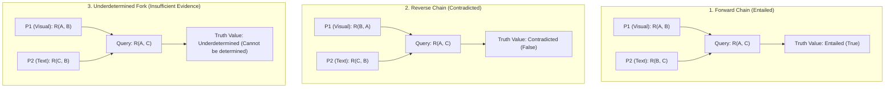

# Experimental Protocol: Cross-Modal Relational Reasoning and Evidence Insufficiency

**Document ID:** `PROTO-0001`  
**Phase:** Phase 0A / D1 (Foundation & Specifications)  
**Status:** Living Protocol  

---

## 1. Experimental Objectives

This protocol provides the formal, reproducible procedure to evaluate and mechanistically diagnose vision-language Transformers on multi-premise relational reasoning. The protocol is structured to:
1. Measure behavioral accuracy across three distinct logical topologies: Forward Chains ($\top$), Reverse Chains ($\bot$), and Underdetermined Forks ($?$).
2. Isolate failure modes using a comprehensive battery of negative, unimodal, and permutation controls.
3. Establish data splits, candidate-answer token scoring, and rigorous statistical testing standards.

---

## 2. Formal Relational Setting & Stimulus Design

### Canonical Relation Definition
We evaluate reasoning over a single directional relation $R(x, y)$, defined as:
$$\text{Object } x \text{ is strictly to the left of object } y \quad (\text{i.e. } x(x) < x(y))$$
where $x, y \in \mathcal{O}$ are distinct, recognizable geometric objects or icons placed on a neutral background.

### Multimodal Premise Topologies
Each test instance consists of:
* **Premise 1 ($\mathcal{P}_1$ — Visual):** A synthetic image containing two objects $A$ and $B$, visually establishing $R(A, B)$ or $R(B, A)$.
* **Premise 2 ($\mathcal{P}_2$ — Textual):** A natural language assertion establishing a relation between $B$ and a third object $C$ (e.g., `"The blue cube is to the left of the green cylinder"`).
* **Target Query ($Q$ — Textual):** A directional question: `"Is object A to the left of object C?"` ($R(A, C)$).

```text
[Premise 1: Visual]        [Premise 2: Textual]              [Query]
Image shows: (A) ... (B)  + Text: "B is to the left of C"  -> "Is A to the left of C?"
```

### The Three Core Topologies



1. **Forward Chain (Entailed $\top$):**
   * $\mathcal{P}_1: R(A, B)$ (Visual), $\mathcal{P}_2: R(B, C)$ (Textual).
   * Query: $R(A, C)$.
   * *Ground Truth:* **Entailed (True)**.
2. **Reverse Chain (Contradicted $\bot$):**
   * $\mathcal{P}_1: R(B, A)$ (Visual), $\mathcal{P}_2: R(C, B)$ (Textual).
   * Logical Implication: $R(C, B) \land R(B, A) \implies R(C, A) \implies \neg R(A, C)$.
   * Query: $R(A, C)$.
   * *Ground Truth:* **Contradicted (False)**.
3. **Underdetermined Fork (Insufficient Evidence $?$):**
   * $\mathcal{P}_1: R(A, B)$ (Visual), $\mathcal{P}_2: R(C, B)$ (Textual).
   * Query: $R(A, C)$.
   * Both $A$ and $C$ are to the left of $B$. The relative order of $A$ and $C$ is completely unconstrained by the premises ($A \prec C \prec B$ or $C \prec A \prec B$ are both valid).
   * *Ground Truth:* **Underdetermined / Insufficient Evidence**.
   * *Target Behavior:* The model must abstain or answer `"Cannot be determined"` / `"Insufficient evidence"`.

---

## 3. Candidate-Answer Token Scoring Methodology

Modern VLM tokenizers (e.g. Llama-3, Qwen, SmolVLM) do not represent answer choices as uniform single tokens. For example, `"Yes"` may be a single token, but `"Undetermined"` or `"Cannot be determined"` spans multiple sub-tokens (e.g., `["Und", "etermined"]` or `["Cannot", " be", " determined"]`).

To ensure unbiased, reproducible evaluation:

### 1. Sequence Log-Likelihood Formulation
For each candidate answer sequence $Y_c = (y_{c, 1}, y_{c, 2}, \dots, y_{c, T_c}) \in \mathcal{C}$ where:
$$\mathcal{C} = \{\text{"Yes"}, \text{"No"}, \text{"Undetermined"}\}$$
we compute the conditional sequence log-likelihood under teacher forcing:
$$\log P(Y_c \mid X) = \sum_{t=1}^{T_c} \log P(y_{c, t} \mid X, y_{c, <t})$$

### 2. Length-Normalized Candidate Scoring
To prevent tokenizers from artificially penalizing multi-token sequences, we apply length normalization:
$$\text{score}(Y_c) = \frac{1}{T_c^\alpha} \sum_{t=1}^{T_c} \log P(y_{c, t} \mid X, y_{c, <t})$$
where $\alpha \in [0.5, 1.0]$ is a length penalty parameter (default $\alpha = 1.0$).

### 3. Normalized Candidate Likelihood vs. Calibrated Probability
* **Normalized Candidate Likelihood ($P_{\text{cand}}$):** Softmax over the normalized candidate scores across $\mathcal{C}$:
$$P_{\text{cand}}(Y_c) = \frac{\exp(\text{score}(Y_c) / \tau)}{\sum_{c' \in \mathcal{C}} \exp(\text{score}(Y_{c'}) / \tau)}$$
where $\tau$ is the softmax temperature (default $\tau = 1.0$).
* **Epistemic Invariant:** $P_{\text{cand}}$ represents *relative competitive likelihood among closed candidates*. It must **not** be confused with *calibrated correctness probability*, which requires empirical temperature scaling or Platt scaling on a validation split.

---

## 4. Control Batteries & Negative Controls

To ensure that high accuracy reflects genuine multi-premise cross-modal reasoning rather than unimodal shortcuts or memorized artifacts, every model must be evaluated against five rigorous control batteries:

### Control 1: Individual-Premise Comprehension Verification
* **Visual Premise Check:** Query $R(A, B)$ directly on the image with no text premise present.
* **Textual Premise Check:** Query $R(B, C)$ directly on the text premise with no image present.
* **Evaluation Standard:** Isolated premise competence is established if accuracy is statistically indistinguishable from model baseline performance on standard unimodal benchmarks, and significantly higher than on compositional queries ($p < 0.001$, McNemar's test).

### Control 2: Text-Only Negative Controls (Masked Image)
* Replace the visual premise $\mathcal{P}_1$ with a blank or Gaussian noise image, leaving only $\mathcal{P}_2$ and the query.
* *Expected Behavior:* The query $R(A, C)$ cannot be determined from text alone. Definite predictions above chance indicate language priors or lexical shortcuts ($H_{\text{shortcut}}$).

### Control 3: Visual-Only Negative Controls (Masked Text)
* Remove the textual premise $\mathcal{P}_2$, presenting only the image $\mathcal{P}_1$ and the query.
* *Expected Behavior:* The query cannot be determined from the image alone (object $C$ does not appear in the image). Any definite answer reflects hallucination or position bias.

### Control 4: Entity-Order & Lexical Permutations
* For every premise template, evaluate all isomorphic entity renamings (e.g., swapping label $A$ with $C$, or using novel shape/color names).
* *Acceptance Criterion:* Model predictions must remain statistically invariant under isomorphic relabeling.

### Control 5: Spatial Coordinate Perturbations
* For visual premises, vary the horizontal distance and vertical alignment between objects $A$ and $B$ (jittering scale, aspect ratio, and 2D canvas position while preserving strict $x(A) < x(B)$).

---

## 5. Evaluation Splits & Dataset Structure

To prevent data contamination and ensure out-of-distribution validity, stimuli are generated across strictly disjoint splits:

* **Primitive Sets:**
  * Entities: $\mathcal{O} = \mathcal{O}_{\text{in-distribution}} \cup \mathcal{O}_{\text{held-out}}$ ($\mathcal{O}_{\text{ID}} \cap \mathcal{O}_{\text{held-out}} = \emptyset$).
  * Visual Attributes: Disjoint color palettes, shapes, and textures reserved exclusively for held-out evaluation.
* **Sample Size Requirements:**
  * Minimum $N = 500$ instances per condition (Forward Chain, Reverse Chain, Underdetermined Fork).
  * Minimum $N = 500$ instances per control battery.
  * Total evaluation suite per model: $\ge 4,000$ validated instances.

---

## 6. Statistical Standards & Decision Framework

We explicitly reject arbitrary percentage thresholds. All reporting adheres to four statistical tiers:

1. **Descriptive Confidence Intervals:**
   * Every metric is reported with a **95% bootstrap confidence interval** computed across $B = 1,000$ resamples of the evaluation split.
2. **Pre-Registered Hypothesis Tests:**
   * Differences against chance baselines (50% binary, 33.3% 3-way) are evaluated using two-sided binomial tests.
   * Paired comparisons (e.g., isolated premise accuracy vs. compositional query accuracy) are evaluated using McNemar's test for paired binary outcomes.
3. **Multiple-Comparison Corrections:**
   * When screening multiple attention heads ($H$) or layers ($L$) for candidate intervention targets, false discovery rates are controlled using the **Benjamini-Hochberg (BH)** procedure at $\alpha = 0.05$.
4. **Practical Effect Sizes & Causal Intervention Metrics:**
   * **Primary Metric (Raw Logit Shift):**
     $$\Delta \text{Logit}_{\text{patch}} = \text{Logit}_{\text{patched}} - \text{Logit}_{\text{corrupted}}$$
     Raw logit shifts serve as the primary, unnormalized measurement of causal effect, avoiding ratio artifacts.
   * **Normalized Indirect Effect (NIE):**
     $$\text{NIE} = \frac{\text{Logit}_{\text{patched}} - \text{Logit}_{\text{corrupted}}}{\text{Logit}_{\text{clean}} - \text{Logit}_{\text{corrupted}}}$$
   * **Denominator Instability Guard:**
     When the clean-corrupted separation is small ($|\text{Logit}_{\text{clean}} - \text{Logit}_{\text{corrupted}}| < \delta_{\text{denom}}$, default $\delta_{\text{denom}} = 1.0\text{ logit}$), $\text{NIE}$ exhibits numerical instability and is not computed. The instance is flagged `UNSTABLE_BASELINE (INSUFFICIENT_SEPARATION)`, and analysis relies exclusively on raw logit shift $\Delta \text{Logit}_{\text{patch}}$.
   * **No Universal Effect-Size Cutoffs:**
     We reject universal magic numbers (e.g. arbitrary $\text{NIE} \ge 0.20$). Meaningful causal mediation is established via pre-registered, experiment-specific criteria: statistically significant separation from negative controls (two-sample permutation test $\Delta \text{Logit}_{\text{patch}} > \Delta \text{Logit}_{\text{shuffled}}$ with $p < 0.01$) alongside 95% bootstrap confidence intervals and Cohen's $d$.

---

## 7. Reproducibility & Seeding Standards

* **Deterministic Generation:** All synthetic image generation and text prompt assembly must be governed by fixed, logged random seeds (`SEED=42, 1337, 2026`).
* **Environment Logging:** Every experimental run must record commit hash, Python version, PyTorch version, CUDA runtime, and exact hardware configuration.
* **Zero Model Selection without Hardware Validation:** Candidate models must be benchmarked under identical batch-size-1 inference conditions to guarantee exact memory and execution reproducibility under 4 GB VRAM.
