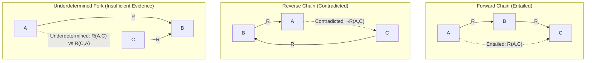

# Research Specification: Cross-Modal Relational Reasoning and Evidence Insufficiency

**Document ID:** `SPEC-0001`  
**Phase:** Phase 0A / D1 (Foundation & Specifications)  
**Status:** Living Specification  

---

## 1. Scientific Problem Formulation

State-of-the-art vision-language Transformers (VLMs) have demonstrated impressive capabilities on perceptual recognition and isolated visual question answering. However, their internal capacity for **compositional relational reasoning** across multimodal premises remains poorly understood and highly brittle. Specifically:
1. **Multi-Premise Compositional Collapse:** When a reasoning task requires chaining an established visual relation (Premise 1) with an established textual relation (Premise 2) to deduce an unstated cross-entity relation (Query), compact VLMs frequently fail despite demonstrating competent recognition of both isolated premises.
2. **Failure of Epistemic Calibration under Insufficient Evidence:** When presented with relational graphs containing missing evidentiary links (e.g., an underdetermined fork where $A$ and $C$ are each related to $B$, but their mutual relation is unconstrained), models frequently hallucinate definite directional conclusions rather than identifying that the evidence is insufficient to determine the query.

The primary objective of **CrossModalLab** is to perform a mechanistic, layer-by-layer diagnosis of compact open-weights vision-language Transformers to discover *where* and *why* these models fail to compose cross-modal relations and why they fail to abstain when evidence is insufficient.

---

## 2. Logical Formalization: The Chain-Versus-Fork Paradigm

We formalize relational reasoning using a single binary relation $R$ defined over a domain of distinct objects $\mathcal{O} = \{A, B, C, \dots\}$.

### Axiomatic Grounding
Let $R(x, y)$ denote a strict, transitive, asymmetric binary relation. In our canonical spatial setting, $R(x, y)$ represents **"object $x$ is strictly to the left of object $y$"** along a 1D horizontal projection $x(\cdot)$:
1. **Irreflexivity:** $\forall x \in \mathcal{O}, \neg R(x, x)$.
2. **Asymmetry:** $\forall x, y \in \mathcal{O}, R(x, y) \implies \neg R(y, x)$.
3. **Transitivity:** $\forall x, y, z \in \mathcal{O}, R(x, y) \land R(y, z) \implies R(x, z)$.
4. **Strict Total Order:** For any distinct $x, y \in \mathcal{O}$, exactly one of $R(x, y)$ or $R(y, x)$ holds.

### Relational Topologies and Epistemic Classifications
Given a multimodal premise set $\mathcal{P} = \{\text{Premise}_1, \text{Premise}_2\}$, we evaluate the model against a binary directional query $Q = R(A, C)$ ("Is $A$ to the left of $C$?").

| Topology | Premises $\mathcal{P}$ | Query $Q$ | Truth / Epistemic Status | Formal Semantics |
| :--- | :--- | :--- | :--- | :--- |
| **Forward Chain** | $R(A, B) \land R(B, C)$ | $R(A, C)$ | **Entailed ($\top$)** | In all models $\mathcal{M} \models \mathcal{P}$, $R(A, C)$ evaluates to True. |
| **Reverse Chain** | $R(B, A) \land R(C, B)$ | $R(A, C)$ | **Contradicted ($\bot$)** | In all models $\mathcal{M} \models \mathcal{P}$, $R(C, A)$ is true, which strictly implies $\neg R(A, C)$. $R(A, C)$ evaluates to False. |
| **Underdetermined Fork** | $R(A, B) \land R(C, B)$ | $R(A, C)$ | **Underdetermined ($?$)** | There exist models $\mathcal{M}_1 \models \mathcal{P}$ where $R(A, C)$ is True (order: $A \prec C \prec B$) and models $\mathcal{M}_2 \models \mathcal{P}$ where $R(A, C)$ is False (order: $C \prec A \prec B$). The query cannot be determined from the premises. |

> [!IMPORTANT]
> **Crucial Epistemic Distinction:**
> An underdetermined query is **not** a false query. A model that outputs "No" or forces a guess on an underdetermined fork is suffering from an **abstention and epistemic calibration failure**, conflating lack of positive proof with proof of falsehood.

---

## 3. Core Research Questions (RQs)

* **RQ1 (Locus of Relational Composition):** In which Transformer layer(s) and computational sub-modules (e.g., self-attention, cross-attention if present, or feed-forward MLPs) is the transitive relationship $R(A, C)$ computed from $R(A, B)$ and $R(B, C)$?
* **RQ2 (Mechanistic Failure Mode Attribution):** What is the causal breakdown when multi-premise reasoning fails? Is failure driven by perceptual errors, textual comprehension deficits, cross-modal integration failure, or late-stage language prior overrides?
* **RQ3 (Representation of Epistemic Insufficiency):** Do internal hidden representations encode the topological difference between complete chains and underdetermined forks? If so, why does the decoding/readout head fail to map this state to an explicit abstention token?

---

## 4. Competing Falsifiable Hypotheses

To avoid preconceptions, we formalize six competing, falsifiable hypotheses. For each hypothesis, we explicitly distinguish behavioral observations, linear-probe decoding evidence, causal activation-intervention evidence, alternative explanations, and multi-method falsification conditions.

### Methodological Invariants on Scientific Inference
1. **Probe Decodability $\neq$ Causal Usage:** Probes measure information accessibility to an external diagnostic model. A high probe score does not prove that subsequent Transformer layers rely on that representation.
2. **Probe Failure $\neq$ Feature Absence:** If a probe fails, the representation may be non-linear, distributed across orthogonal subspaces, or present in a different token position. Probe failure alone cannot falsify a hypothesis.
3. **Activation Patching Does Not Prove Uniqueness:** Activation patching demonstrates causal mediation along the evaluated circuit path. It does not prove that the identified component is the unique necessary and sufficient mechanism without exhaustive path patching, multi-component ablation, and checking for parallel redundant pathways.
4. **No Arbitrary Accuracy Cutoffs:** We reject arbitrary percentage thresholds (e.g., `95%` or `80%`). All empirical decisions rely on:
   - Descriptive confidence intervals (95% bootstrap CIs with $B \ge 1,000$ resamples).
   - Pre-registered hypothesis tests against task-appropriate chance baselines.
   - Multiple-comparison corrections (Bonferroni / Benjamini-Hochberg) where multiple heads/layers are evaluated.
   - Practical effect sizes (Normalized Indirect Effect, Cohen's $d$, odds ratios).

---

### Hypothesis 1: $H_{\text{percep}}$ (Visual Perception Failure)
*The vision encoder fails to resolve or maintain individual object tokens and their geometric coordinates, passing degraded representations into the language backbone.*
1. **Behavioral Observations:** Model performs poorly on single-premise visual-only control queries $R(A, B)$ (statistically indistinguishable from chance).
2. **Linear-Probe Evidence:** Linear probes trained on early visual prefix/cross-attention tokens fail to decode pairwise relations $R(A, B)$ above chance across multiple regularization penalties.
3. **Causal Intervention Evidence:** Patching clean visual representations from an oracle run into early visual layers restores downstream compositional task performance (substantial positive Normalized Indirect Effect).
4. **Alternative Explanations:** The visual encoder produces adequate features, but the multimodal projection bottleneck (e.g., MLP connector) corrupts spatial coordinates during projection.
5. **Conditions Weakening/Falsifying the Hypothesis:** Single-premise visual control accuracy is significantly higher than chance ($p < 0.001$, binomial test) and indistinguishable from model performance on standard perceptual benchmarks; linear probes reliably decode $R(A, B)$ from visual tokens across held-out splits; and patching clean visual features produces no significant change in downstream compositional error.

### Hypothesis 2: $H_{\text{text}}$ (Textual Premise Comprehension Failure)
*The language backbone fails to parse or retain the linguistic relational premise $R(B, C)$ in the multimodal context.*
1. **Behavioral Observations:** Model performs near chance on text-only premise queries $R(B, C)$ when evaluated within the same prompt template.
2. **Linear-Probe Evidence:** Linear probes on textual token representations fail to decode $R(B, C)$ above chance across layers.
3. **Causal Intervention Evidence:** Corrupting the text premise tokens produces zero significant change in output logits.
4. **Alternative Explanations:** The textual premise is comprehended in isolation, but visual prefix tokens globally distract attention away from text representations (*attention distraction*).
5. **Conditions Weakening/Falsifying the Hypothesis:** Model demonstrates robust text-only reasoning on identical templates; linear probes decode $R(B, C)$ with high confidence in language layers; and corrupted textual premises directly flip model predictions.

### Hypothesis 3: $H_{\text{comp}}$ (Cross-Modal Relational Composition Failure)
*Both $R(A, B)$ and $R(B, C)$ are accessible in early/middle layers, but cross-modal attention mechanisms fail to route and compose intermediate tokens across modal boundaries to synthesize $R(A, C)$.*
1. **Behavioral Observations:** Model succeeds on both isolated visual and textual premises, but drops to near-chance on the compositional query $R(A, C)$ (statistically significant drop, $p < 0.001$, McNemar's test).
2. **Linear-Probe Evidence:** Probes reliably decode $R(A, B)$ and $R(B, C)$ in intermediate layers, but residual stream probes at the final token position fail to decode the composed relation $R(A, C)$ above chance.
3. **Causal Intervention Evidence:** Activation patching of intermediate candidate composition heads into a corrupted run fails to transfer the composed prediction; conversely, path patching confirms that information flows from premises do not converge on a common composition head.
4. **Alternative Explanations:** The composed relation is computed non-linearly or distributed across multiple heads rather than readable linearly from the residual stream.
5. **Conditions Weakening/Falsifying the Hypothesis:** Linear probes reliably decode $R(A, C)$ from the intermediate residual stream across multiple layers; and patching intermediate activations into a corrupted run causally flips the prediction to the correct composed relation.

### Hypothesis 4: $H_{\text{gen}}$ (Readout / Generation Collapse)
*A composed cross-modal representation of $R(A, C)$ is formed in intermediate layers, but late-stage MLPs or unembedding layers override this representation with strong language priors or superficial positional biases.*
1. **Behavioral Observations:** Model consistently predicts an ungrounded majority token (e.g., always "Left") regardless of visual or relational input permutations.
2. **Linear-Probe Evidence:** Probes decode the correct composed relation $R(A, C)$ with high accuracy in middle layers, but probe accuracy collapses or logits diverge in the final 2–3 layers.
3. **Causal Intervention Evidence:** Patching clean intermediate activations into a corrupted run flips intermediate probes but fails to flip the final output logit; conversely, ablating late MLP heads restores visually grounded predictions.
4. **Alternative Explanations:** The late-layer divergence is due to vocabulary projection bottlenecks or uncalibrated candidate answer tokenization rather than active MLP overriding.
5. **Conditions Weakening/Falsifying the Hypothesis:** Intermediate residual streams fail to decode $R(A, C)$ across all intermediate layers under both linear and non-linear probes; or causal patching of late MLPs produces zero change in output logit margins.

### Hypothesis 5: $H_{\text{abstain}}$ (Abstention / Epistemic Calibration Failure)
*The network internally represents the underdetermined fork topology as structurally distinct from complete chains, but the final readout lacks an epistemic gate or calibrated threshold to output an explicit "undetermined" token, defaulting to forced guessing.*
1. **Behavioral Observations:** Model produces overconfident binary outputs ("Yes" / "No") on underdetermined forks while refusing to produce an abstention token.
2. **Linear-Probe Evidence:** A linear classifier trained on intermediate hidden states achieves statistically significant separation in discriminating between **Complete Chains** and **Underdetermined Forks** ($p < 0.001$, bootstrap CI above chance).
3. **Causal Intervention Evidence:** Steering activations along the identified "chain vs. fork" direction causally increases the candidate log-likelihood of the abstention response.
4. **Alternative Explanations:** The model treats underdetermined forks as random noise or out-of-distribution inputs rather than representing topological underdetermination.
5. **Conditions Weakening/Falsifying the Hypothesis:** Probes fail to distinguish complete chains from underdetermined forks across all layers and token positions; and steering activations along topological probe directions fails to increase candidate abstention likelihood.

### Hypothesis 6: $H_{\text{shortcut}}$ (Superficial Heuristic / Shortcut Learning)
*The model appears to succeed on specific relational chains not by performing compositional inference, but by exploiting superficial tokens, token positions, entity order, or dataset statistical artifacts.*
1. **Behavioral Observations:** Model performance drops dramatically when entity names are swapped, when prompt phrasing is inverted, or when image coordinates are symmetrically mirrored.
2. **Linear-Probe Evidence:** Probes trained on random or entity-permuted hidden states achieve comparable accuracy to probes on true relational states.
3. **Causal Intervention Evidence:** Ablating candidate composition heads produces zero drop on chain evaluation, while modifying superficial prompt formatting destroys performance.
4. **Alternative Explanations:** Entity-swapping introduces out-of-distribution lexical tokens that confuse the language model's tokenizer.
5. **Conditions Weakening/Falsifying the Hypothesis:** Performance remains statistically invariant across exhaustive entity permutations, prompt paraphrasing, and spatial coordinate rotations; and causal patching isolates a dedicated head whose ablation specifically degrades relational composition while preserving superficial formatting.

---

## 5. Scope & Explicit Exclusions

### In Scope
* Diagnostic analysis of compact, open-weights vision-language Transformers ($\le 3\text{B}$ parameters, runnable on 4 GB VRAM under quantization or CPU offload).
* Synthetic and highly controlled visual-textual stimuli where ground truth relational topologies are mathematically verified.
* Linear probing, capacity-controlled probing, bootstrap confidence intervals, and targeted causal activation patching.

### Explicitly Excluded
* Training billion-parameter models from scratch.
* Modifying loss functions or fine-tuning pipelines during Phase 0 / Phase D1.
* Uncontrolled web-scraped image benchmarks where relations cannot be programmatically verified.
* Proposing ad-hoc architectural fixes prior to completing causal mechanistic localization.

---

## 6. Hardware Constraints & Gate Criteria

* **VRAM Boundary:** 4096 MiB ceiling on local NVIDIA RTX 2050 Laptop GPU.
* **Model Selection Gate (Phase 0B):** No candidate VLM will be selected based solely on theoretical parameter counts. Every candidate must pass an empirical memory-profiling preflight under batch size 1 and forward-only execution before adoption.
  - *Primary Candidate:* `SmolVLM-500M-Instruct` (targeted for bfloat16 batch-size-1 execution).
  - *Secondary Candidate:* `SmolVLM-2B` (requires 4-bit quantization or CPU offloading).
* **Storage Quarantine:** All experiments, activations, caches, and datasets must reside on drive `E:\Workspace\Active\CrossModalLab`. Drive `C:` remains strictly quarantined.

---

## 7. Standards for Claiming Novelty

Before any claim of scientific novelty is asserted in publications or reports:
1. **Literature Collision Audit:** Full-text verification against existing publications (*Too Late to Recall*, *When RAG Hurts*, *Causal Route Gating*, *Back Attention*, *CF-VLM*, etc.) must confirm no prior work has demonstrated the identical causal mechanism on multimodal chain-vs-fork topologies.
2. **Causal Proof Required:** Probing alone will not be used to claim discovery of an internal mechanism; causal activation interventions (showing both necessity and sufficiency along verified circuits) are mandatory.
3. **Statistical Significance:** All empirical findings must report 95% bootstrap confidence intervals across at least $N = 500$ distinct evaluated samples with entity-disjoint splits and multiple-comparison corrections.
