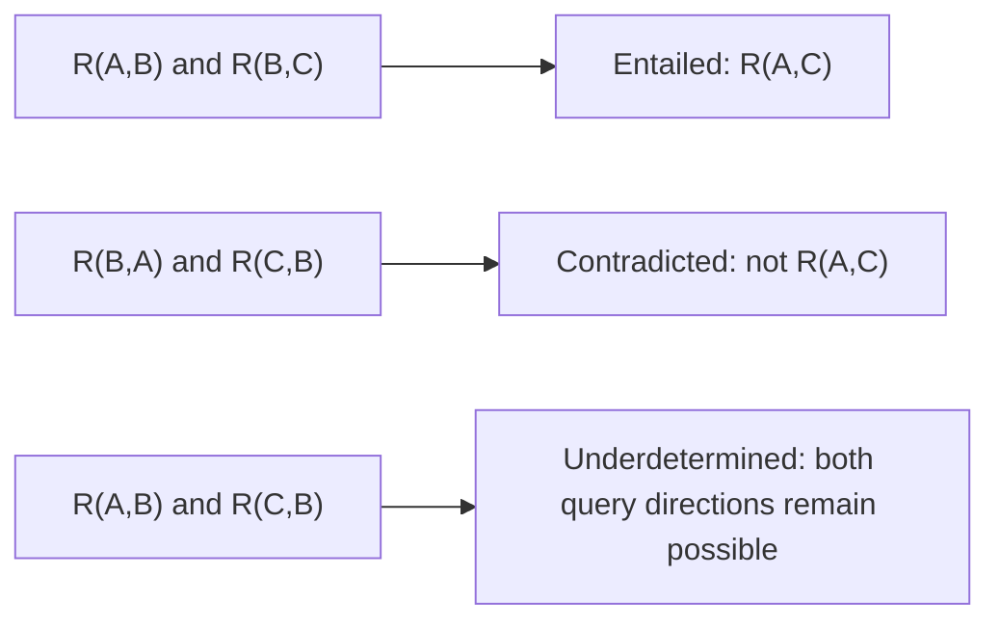
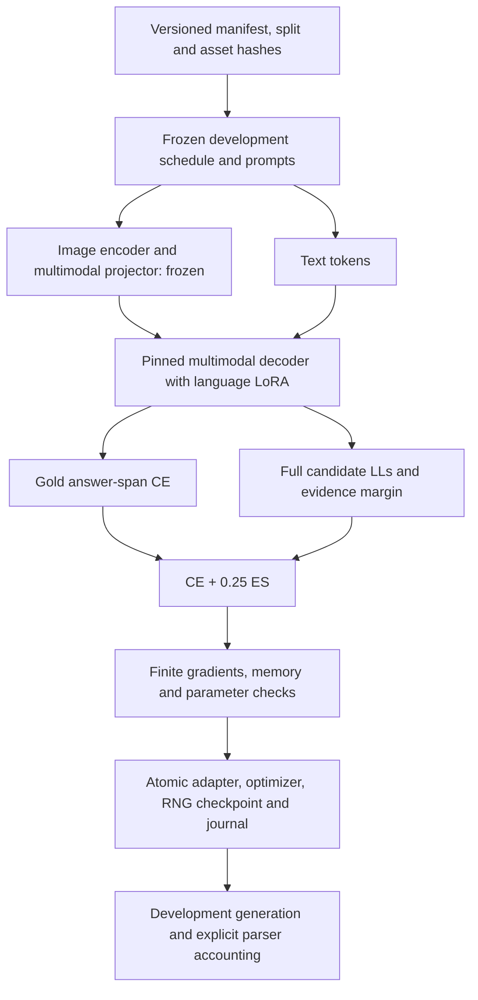

# Conceptual schematics

These are logical and workflow schematics, not experimental observations or benchmark records. No synthetic demonstration data enters the empirical tables.

## Figure 1: epistemic states for strict left-of

The two premises may be distributed across image and text. In the fork, the evidence leaves the ordering of A and C open. Underdetermined does not mean false. Inconsistent premises require a separate policy and are outside this three-state example.

## Figure 2: experiment and audit pipeline

This diagram indicates functional roles. It does not claim that a particular hidden layer implements logical composition. The diagram omits patching because no new intervention is authorized in this mission.
