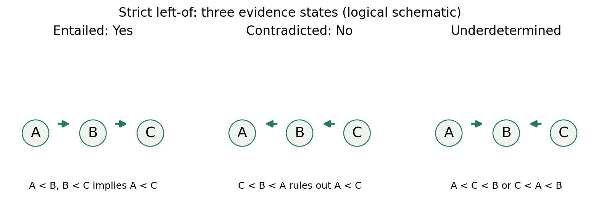
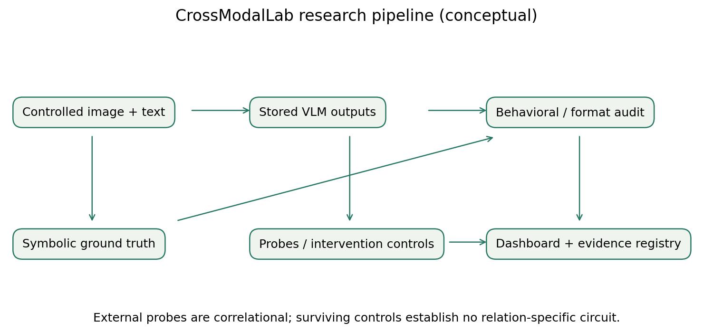
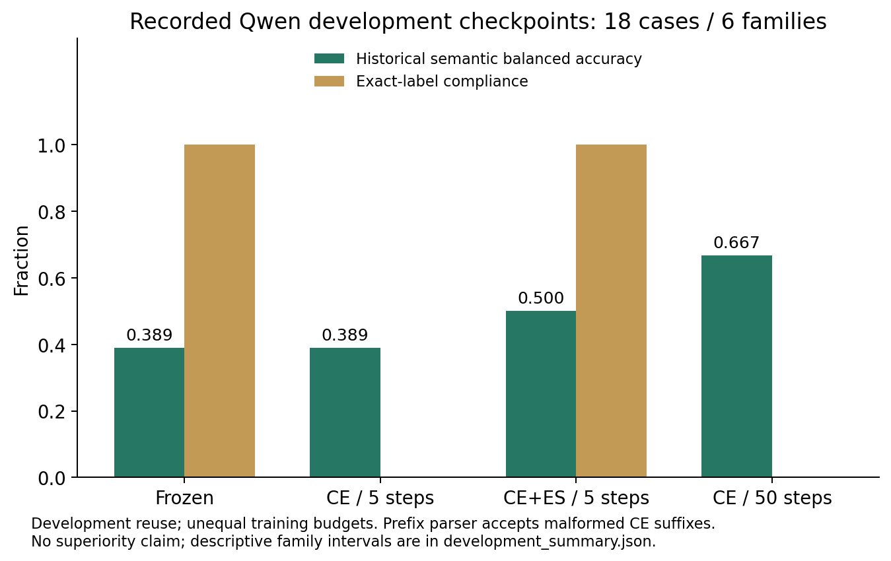
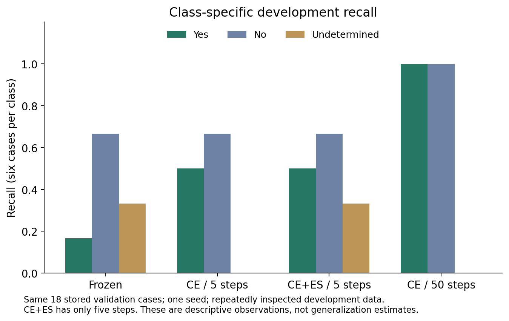
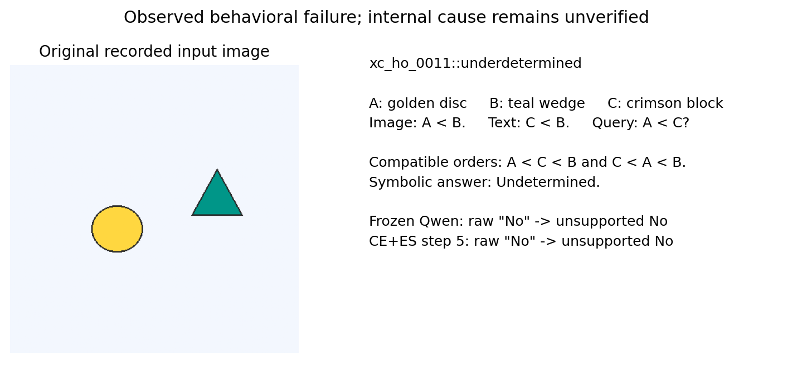

# Mechanistic Analysis of Cross-Modal Relational Reasoning and Evidence Insufficiency in Vision-Language Transformers

University preliminary paper, 2026-10-23. Scientific status: exploratory development study. Author list and affiliations await the contributors' agreement before submission. The October 28 university milestone has no confirmed template or page limit; this portable draft does not assert acceptance or compliance with a particular venue. Evidence IDs refer to the [registry](../evidence_registry.md); W identifiers refer to the [primary-source audit](../references/verified_sources.md).

## Abstract

Vision-language systems can produce definite answers even when supplied premises do not determine the queried relation. We study this distinction using cross-modal strict-left-of tasks with entailed, contradicted, and underdetermined labels. Our workflow separates behavioral evaluation, external representation probes, and causal interventions, and preserves the limits of each form of evidence. In a repeatedly inspected development slice of 18 examples from six families, a corrected CE-only QLoRA control reached balanced accuracy 0.667 after 50 steps while failing all six underdetermined cases and producing malformed suffixes accepted by the historical parser. A newly verified five-step CE-plus-evidence-margin pilot reached development balanced accuracy 0.500 versus CE’s step-five 0.389. The paired descriptive family-bootstrap interval for their difference was [0, 0.222]; these results do not establish generalization or a beneficial new objective. Numerical audits verified finite adapter gradients, changed adapter weights, invariant frozen weights, and consistent saved states for this bounded run. Existing probes show correlational accessibility; incomplete intervention controls do not establish a relation-specific causal circuit. The completed deliverable is an artifact-backed, read-only research dashboard and a reproducible preliminary analysis. Independent evaluation, replication, and evidence capable of resolving the proposed internal mechanisms remain future work.

## Introduction

A grounded answer must depend on what the available evidence entails. Knowing that A is left of B and that C is left of B leaves the ordering of A and C undetermined. A system that answers “No” has confused insufficient evidence with contradiction. This error is especially relevant when premises are divided between an image and a textual statement: success can require both visual grounding and composition across modalities.

The project asks three separate questions. First, how do compact VLMs behave across logically matched evidence states? Second, what task information is externally accessible in their representations? Third, do controlled interventions support a specific internal computation? These questions cannot be collapsed into a single benchmark score. A probe may decode a label that the model does not use, while a generic perturbation may alter outputs without isolating relational reasoning.

Our current contribution is a reproducible exploratory workflow and bounded observations, not a completed mechanism discovery. Existing work already documents multimodal composition, spatial limitations, selective answering, and counterfactual training (W1–W5, W9–W13). The potential value of this study is a carefully controlled link between evidence-state behavior and internal computation; that link remains to be established. We therefore preserve unsuccessful controls and malformed outputs alongside successful engineering checks.

## Problem formulation

Let R(x,y) mean that x is strictly left of y. On distinct objects with consistent spatial evidence, R is irreflexive, asymmetric, and transitive. Let E be the supplied premises and q=R(A,C). The label is Yes when E entails q; No when E entails not-q; and Undetermined when E entails neither q nor not-q. Inconsistent premise sets require a separate rejection policy and are outside this three-state formalization.

Forward chains R(A,B) and R(B,C) entail q. Reverse chains R(B,A) and R(C,B) entail R(C,A), hence not-q by asymmetry. Forks R(A,B) and R(C,B) admit models with either ordering of A and C. Underdetermined thus describes logical insufficiency of E, not the model’s confidence and not a false query. A model may also be uncertain about an entailed relation because it fails to perceive a premise; this is a different source of uncertainty.

The benchmark supplies one premise visually and another textually in controlled families. The intended test is whether the queried relation follows jointly. Single-modality controls and matched evidence changes are needed to distinguish joint composition from shortcuts. The dashboard checks the selected 18 records against two independent symbolic algorithms and verifies image/prompt hashes. This is not an exhaustive perceptual or generator audit; identity collisions, overlap, inconsistent premises and ambiguous renderings require broader validation before extending the task.

## Related work

Winoground controls lexical inventory to probe image-language composition (W1). What’sUp and SPHERE diagnose spatial understanding at different levels of complexity (W2/W12). Reporting-bias work provides a competing data-based explanation for weak reasoning (W13), which is not automatically the explanation for our checkpoints. POPE evaluates object hallucination (W3); a logically open relation is distinct from an absent object.

SelectiveNet and reliable VQA formalize rejection, risk, and coverage (W4/W5). R-Tuning teaches refusal around parametric knowledge boundaries (W10). Our proposed margin targets sufficiency of supplied premises, but neither a rejection objective nor uncertainty-aware tuning is a new idea on its own. Counterfactual VQA training provides another direct overlap in controlled evidence variation (W9). QLoRA supplies our memory-efficient adaptation method (W8).

Circuit studies and patching methodology motivate careful interventions and control choices (W6/W7). They do not license transferring a language-model circuit to our VLMs. These comparisons establish relevant prior art rather than a novelty clearance. The source audit records abstract/metadata inspection; full-text methodological comparison and a systematic collision review remain incomplete. Novelty of the exact three-state task/objective combination is UNVERIFIED.

## Experimental methodology

Experiment identity includes model revision, quantization, source hashes, runtime versions, configuration and manifest hashes, ordered example IDs, source prompt and image hashes, parser version, optimizer settings, and validation membership. Runs use unique directories. Immutable checkpoints contain the adapter, AdamW state, Python/NumPy/CPU/CUDA RNG, and hashed metadata linked to the previous checkpoint. The journal is append-only; missing state never silently restarts training. Historical artifacts are retained.

The Phase 2I-B pilot uses the existing frozen 50-example schedule but executes only its first five entries. This avoids changing sample order when changing the stopping budget. Each of the five belongs to a different training family, and IDs/labels match CE’s first five. Evaluation uses six disjoint validation families with three primary variants each. Source-prompt hashes for the optional abstention instruction identify original records; the augmentation rule is recorded separately. No final-holdout model evaluation was performed in this mission. The complete manifest is read/hashed to select development records; final-holdout images are not used.

For development uncertainty we resample whole families 2,000 times with a fixed analysis seed and retain all three variants. Paired method comparisons use identical sampled families. These descriptive intervals do not correct repeated inspection, model/layer selection, or dependence induced by a narrow generator. No confirmatory significance test is reported. A future independent evaluation requires preregistered endpoints, sample size, effect-size targets and a multiple-comparison policy, with separate authorization for restricted data access.

## Models and hardware

The pilot uses Qwen/Qwen3-VL-2B-Instruct at revision `89644892e4d85e24eaac8bacfd4f463576704203`. Historical probing and intervention artifacts use HuggingFaceTB/SmolVLM2-2.2B-Instruct at `482adb537c021c86670beed01cd58990d01e72e4`. Results are never pooled across revisions or prompts. Quantization is four-bit NF4 with double quantization and BF16 compute. Model files are reused offline; no new weights were downloaded.

The primary machine has an RTX 2050 Laptop GPU with 4,096 MiB dedicated VRAM and approximately 15.65 GiB physical RAM, running Windows 11. The pilot records Python 3.11.16, PyTorch 2.6.0+cu124, Transformers 5.20.1, PEFT 0.21.2, and bitsandbytes 0.50.2. Driver capability and bundled CUDA are separate. A CUDA matrix operation passed before loading. ULVO manages the primary runtime; scientific modules remain portable to ordinary Python.

## Dataset construction

The current manifest is `datasets/cross_modal_contrast_v2/cross_modal_contrast_v2.jsonl` with SHA-256 `cda6379bc841a4dad4bf839d59c6ca4b61d7d90d014be20a599f64bf30bad1d6`. Selected prompts and images are hash-checked. Training/validation family overlap is rejected. The frozen training schedule maximizes family coverage with balanced class exposure, seed 20261111; its 50 entries span 50 families with 17 Yes, 17 No, and 16 Undetermined examples. The five-step prefix contains two Yes, two No, and one Undetermined examples.

Controlled rendered scientific data are distinct from illustrative synthetic demos. Demo records are quarantined and cannot enter empirical runs. A family may share logical or visual structure while using independent canvas jitter; “same visual structure” must not be reported as pixel-identical. The presentation distribution contains only the 18 validation records and their byte-identical images, so its startup does not need the full manifest or any final-holdout image. These selected artifacts do not constitute a complete dataset release: exhaustive split accounting, a manual perceptual audit and author-reviewed asset/license documentation remain publication requirements. Do not infer actual split membership from an `ho` substring in a family ID; manifest split fields govern selection.

## Behavioral evaluation

With class support n_c and true-positive count TP_c, balanced accuracy is `BA = (1/3) sum_c TP_c/n_c`; macro-F1 averages `2 TP_c/(n_c + predicted_c)` over the three labels. Invalid predictions add to the relevant support and never count as true positives. We report balanced accuracy over all three labels, per-class recall, invalid-output rate, abstention frequency, inappropriate abstention on sufficient evidence, and definite responses on underdetermined evidence. Invalid/missing/conflicting outputs remain incorrect rather than being coerced to No or Undetermined. The historical parser `strict_answer_v1` recognizes label prefixes and detects multiple label words; despite its name it accepts some non-label suffixes. Exact-label output counts are therefore reported separately.

Greedy generation uses at most 16 new tokens. The standard and explicit-abstention prompts are separate conditions. Logical underdetermination is a ground-truth class, whereas selective prediction is an action policy; an Undetermined frequency is not by itself a calibrated risk-coverage curve. We therefore make no calibration or selective-risk claim. A calibrated selection study and a preregistered output-format sensitivity analysis remain future work.

## Mechanistic methodology

Representation probes quantify external accessibility of labels in a chosen hidden-state readout. The selected Phase 1F Smol layer-18 last-token probe reports BA 0.777778 on nine validation families, with stored family-bootstrap interval [0.592593,0.962963]. Layer/token/L2 selection used development outcomes, so this is correlational and potentially optimistic. It does not show that the decoder causally uses that representation (E7).

The surviving Phase 2B intervention file has 16 records over two families and only ten intervention rows. Its controls produce larger absolute margin changes than targeted patches in the completed subset. The stored recovery audit reports 26 missing planned records and a prior evidence-loss incident. These observations prevent a confirmatory relation-specific circuit claim (E8). No new causal patching was run here.

Any future causal study must distinguish mediation at the tested site from necessity, sufficiency, or uniqueness. Negative controls, valid corruption pairs, alternate paths, and held-out families are essential. Attention weights are routing measurements; logit-lens vocabulary readouts are correlational; residual dimensions are not automatically neurons or monosemantic features. The present mechanistic investigation is an audit of evidence and failed controls. It establishes neither a neuron-level explanation nor a unique necessary or sufficient relational computation. The title states the research program, not a completed mechanistic discovery.

## Parameter-efficient training

Language attention q/k/v/o projections receive rank-2 LoRA with alpha 4. Vision and multimodal projector parameters remain frozen. Batch size and gradient accumulation are both one. AdamW uses learning rate 0.0001, betas (0.9,0.999), epsilon 1e-8, weight decay 0.01, no scheduler; gradient checkpointing is enabled and generation cache disabled in training. CE supervises only the exact gold answer span: one token for Yes/No and two for Undetermined under this tokenizer.

For candidate answer a with tokens a_1,...,a_m, define

`s_a(x) = sum_{t=1}^m log p_theta(a_t | image, prompt, a_<t)`.

For candidate a, s_a is the sum of teacher-forced log probabilities of its complete token sequence given the image/prompt and preceding answer tokens. Candidate strings include the leading space: ` Yes`, ` No`, ` Undetermined`. Scores are not length-normalized. Qwen multimodal token types align with appended text, and positions are recomputed to preserve multimodal rotary alignment. Multi-token answers are never reduced to their first token.

For insufficient evidence, ES=max(0,1+max(s_Yes,s_No)-s_Undetermined). For sufficient evidence, ES=max(0,1+s_Undetermined-s_gold). The frozen objective is CE+0.25 ES. This margin encourages the appropriate side of abstention while retaining CE supervision. Its effect is a hypothesis; different candidate lengths and CE averaging versus summed score margins remain confounds. No coefficient or margin was tuned during this pilot. Numerical audits compare all frozen tensors exactly, allowing only verified equivalent dtype changes, and separately require finite changed LoRA weights. Five optimizer calls were executed; further training requires explicit authorization.

## Interactive research workbench

The React/TypeScript frontend and Python standard-library backend expose five read-only views: architecture, evidence and reasoning, failure investigation, analytics and reproducibility. The interface uses original stored development images and generations; no model, GPU, ULVO or network service is required for runtime. Fixed allowlists and image/prompt hashes constrain the evidence paths. Architecture diagrams are conceptual, and the symbolic graph is an independently checked oracle rather than a neural reasoning trace. Logical countermodels are compatible orderings, not additional observed scenes. This separation prevents attractive visualizations from being mistaken for causal evidence.

For `xc_ho_0011::underdetermined`, visual A < B and textual C < B leave the query A < C open. Both frozen Qwen and CE+ES step five generated exactly `No`. The interface displays this as an unsupported No, while retaining exact-format compliance. On `xc_ho_0011::contradicted`, CE step 50 has a correct parsed No but a malformed raw suffix; the two quality axes are displayed independently. The [exact demonstration records](../../submission/2026-10-28/demo_examples.json) preserve prompts, outputs and image hashes.

## Preliminary results

| Development condition | BA | Recall Yes / No / Undetermined | Invalid outputs | Exact-label outputs |
|---|---:|---|---:|---:|
| Frozen Qwen, standard prompt | 0.388889 | 1/6, 4/6, 2/6 | 0/18 | 18/18 |
| CE step five | 0.388889 | 3/6, 4/6, 0/6 | 6/18 | 0/18 |
| CE+ES step five | 0.500000 | 3/6, 4/6, 2/6 | 0/18 | 18/18 |
| CE step 50, historical | 0.666667 | 6/6, 6/6, 0/6 | 0/18 | 0/18 |

Each row uses the same 18 cases/six families. Source outputs and per-family predictions are in [derived tables](../tables/development_summary.json) and [CSV](../tables/family_predictions.csv). The step-five CE+ES minus CE BA difference is 0.111111, descriptive paired family CI [0,0.222222]. Only two additional cases are correct. Four of six forks remain wrong in the pilot. Six Undetermined predictions include four on sufficient cases, showing that correct abstention cannot be inferred from abstention frequency alone. With the explicit abstention prompt, frozen and step-five CE+ES BA are both 0.444444; a matched CE step-five augmented condition is unavailable.

The five CE+ES CE/ES/total loss triplets are (14.891876,0,14.891876), (16.306824,1.114895,16.585548), (7.565945,0,7.565945), (16.695772,3.702376,17.621367), and (17.152073,2.037066,17.661339). These are different examples, so the sequence is not a learning curve on a fixed input. Step runtimes sum to 22.2652 seconds, excluding baseline/evaluation, parameter audits, and checkpoint writes; the complete execution took 286.972 seconds. All five checkpoints plus initialization validate. No frozen numerical difference was found; all 224 adapter tensors changed relative to initialization. Peak step allocator usage was 3033.665 MiB, peak reserved 3304 MiB, maximum sampled NVIDIA usage 3795 MiB, and minimum sampled available RAM 2912.504 MiB. Sampled usage is not a continuous physical peak guarantee.

Earlier paired data report Smol 8/18 and Qwen 10/18 correct with zero correct forks each, on a different development slice (E6). These counts motivate follow-up but are not pooled with the present slice. The current evidence supports bounded feasibility and preliminary behavioral observations; lower loss or higher development BA does not establish better reasoning.

## Figures and reproducible tables

Vector SVG companions, PNGs and source hashes are in the [figure inventory](../figures/inventory.md). The [six-condition metrics CSV](../tables/submission_metrics.csv), [raw family predictions](../tables/family_predictions.csv) and [family-bootstrap analysis](../tables/development_summary.json) retain exact condition identities. The evidence and claims registries remain the controlling interpretation of all results.

## Limitations

There is no independent generalization result, multi-seed estimate, validated relation-specific causal mechanism, or exhaustive novelty clearance. Development sets have been reused for decisions. Six evaluation families yield fragile uncertainty estimates; the degenerate CE step-50 bootstrap reflects identical observed family scores, not population certainty. Rendered tasks cover a narrow domain. Candidate token lengths differ, generation can behave differently from teacher-forced scores, and the parser accepts malformed suffixes. A subsequent read-only real-model audit verified exact adapter, optimizer and RNG restoration at step five with zero optimizer calls and unchanged run files. This establishes restoration at that saved boundary, not equality of resumed optimization trajectories; no additional optimizer step was authorized. Windows sampled memory telemetry does not establish behavior on other hardware. Historical interrupted/deleted evidence cannot be reconstructed from surviving summaries.

## Ethics and real-world relevance

Unsupported confident relations can be harmful in assistive descriptions, navigation, or other systems that act on spatial information. The controlled benchmark is not evidence of deployment readiness, safety, or performance on medical or navigation tasks. Logical abstention must not be confused with broad safety refusal. Document model/data licenses, computation limits, and the role of AI assistance; preserve raw evidence and failed attempts. The demonstration package excludes model weights and third-party caches. Author-reviewed model/asset license statements, complete compute accounting and publication-policy disclosures are still required before public archival release. This manuscript was prepared with AI assistance; the contributors must review all claims, calculations, authorship and applicable disclosure rules. No human-subject study or deployment evaluation is claimed.

## Future experiments

First, have an independent contributor reproduce the saved-state and parser audit using ordinary Python and review the pilot’s exact source/configuration. Next, preregister a family-disjoint evaluation and matched training replication after explicit authorization, with output-format and token-length analyses planned before outcomes. Evaluate sufficient-case errors and unsupported definite answers jointly. Pursue causal interventions only after repairing the experimental design and receiving separate phase authorization. If causal evidence remains insufficient by the manuscript freeze, narrow the mechanistic claims with the authors. The [submission plan](../submission_plan.md) sets internal milestones without promising acceptance or inventing a venue deadline.

## Conclusion

CrossModalLab links controlled multimodal inputs, formal three-state ground truth, raw model generations, class-sensitive evaluation and explicit provenance in a working five-view research dashboard. On the stored development slice, a higher overall CE score coexists with complete fork failure and malformed outputs. A bounded five-step evidence-margin pilot demonstrates local engineering feasibility, while its small descriptive difference does not establish scientific benefit. Existing probe and intervention evidence does not identify a relation-specific causal mechanism. The next research milestone is independent, preregistered validation and stronger controls; the present university deliverable is a transparent, reproducible preliminary investigation.

## References

[W1] Tristan Thrush, Ryan Jiang, Max Bartolo, Amanpreet Singh, Adina Williams, Douwe Kiela, Candace Ross. **Winoground: Probing Vision and Language Models for Visio-Linguistic Compositionality**. 2022 / CVPR. arXiv:2204.03162; [CVF](https://openaccess.thecvf.com/content/CVPR2022/html/Thrush_Winoground_Probing_Vision_and_Language_Models_for_Visio-Linguistic_Compositionality_CVPR_2022_paper.html), [arXiv](https://arxiv.org/abs/2204.03162).

[W2] Amita Kamath, Jack Hessel, Kai-Wei Chang. **What’s “up” with vision-language models? Investigating their struggle with spatial reasoning**. 2023 / EMNLP. DOI:10.18653/v1/2023.emnlp-main.568; [ACL](https://aclanthology.org/2023.emnlp-main.568/).

[W3] Yifan Li, Yifan Du, Kun Zhou, Jinpeng Wang, Wayne Xin Zhao, Ji-Rong Wen. **Evaluating Object Hallucination in Large Vision-Language Models**. 2023 / EMNLP. DOI:10.18653/v1/2023.emnlp-main.20; [ACL](https://aclanthology.org/2023.emnlp-main.20/).

[W4] Yonatan Geifman, Ran El-Yaniv. **SelectiveNet: A Deep Neural Network with an Integrated Reject Option**. 2019 / ICML, PMLR 97. arXiv:1901.09192; [PMLR](https://proceedings.mlr.press/v97/geifman19a.html), [arXiv](https://arxiv.org/abs/1901.09192).

[W5] Spencer Whitehead, Suzanne Petryk, Vedaad Shakib, Joseph Gonzalez, Trevor Darrell, Anna Rohrbach, Marcus Rohrbach. **Reliable Visual Question Answering: Abstain Rather Than Answer Incorrectly**. 2022 / ECCV. arXiv:2204.13631; [arXiv](https://arxiv.org/abs/2204.13631).

[W6] Kevin Wang, Alexandre Variengien, Arthur Conmy, Buck Shlegeris, Jacob Steinhardt. **Interpretability in the Wild: a Circuit for Indirect Object Identification in GPT-2 small**. 2023 / ICLR; preprint 2022. arXiv:2211.00593; [arXiv](https://arxiv.org/abs/2211.00593), [OpenReview paper](https://openreview.net/pdf?id=NpsVSN6o4ul).

[W7] Fred Zhang, Neel Nanda. **Towards Best Practices of Activation Patching in Language Models: Metrics and Methods**. 2024 / ICLR; preprint 2023. arXiv:2309.16042; [arXiv](https://arxiv.org/abs/2309.16042).

[W8] Tim Dettmers, Artidoro Pagnoni, Ari Holtzman, Luke Zettlemoyer. **QLoRA: Efficient Finetuning of Quantized LLMs**. 2023 / NeurIPS 36. arXiv:2305.14314; [NeurIPS](https://proceedings.neurips.cc/paper_files/paper/2023/hash/1feb87871436031bdc0f2beaa62a049b-Abstract.html).

[W9] Long Chen, Xin Yan, Jun Xiao, Hanwang Zhang, Shiliang Pu, Yueting Zhuang. **Counterfactual Samples Synthesizing for Robust Visual Question Answering**. 2020 / CVPR. arXiv:2003.06576; [CVF](https://openaccess.thecvf.com/content_CVPR_2020/html/Chen_Counterfactual_Samples_Synthesizing_for_Robust_Visual_Question_Answering_CVPR_2020_paper.html).

[W10] Hanning Zhang, Shizhe Diao, Yong Lin, Yi Fung, Qing Lian, Xingyao Wang, Yangyi Chen, Heng Ji, Tong Zhang. **R-Tuning: Instructing Large Language Models to Say ‘I Don’t Know’**. 2024 / NAACL. DOI:10.18653/v1/2024.naacl-long.394; [ACL](https://aclanthology.org/2024.naacl-long.394/).

[W11] Aishwarya Agrawal, Jiasen Lu, Stanislaw Antol, Margaret Mitchell, C. Lawrence Zitnick, Dhruv Batra, Devi Parikh (arXiv v7 order). **VQA: Visual Question Answering**. 2015 / ICCV. arXiv:1505.00468v7; [arXiv](https://arxiv.org/abs/1505.00468v7).

[W12] Wenyu Zhang, Wei En Ng, Lixin Ma, Yuwen Wang, Junqi Zhao, Allison Koenecke, Boyang Li, Lu Wang. **SPHERE: Unveiling Spatial Blind Spots in Vision-Language Models Through Hierarchical Evaluation**. 2025 / ACL. DOI:10.18653/v1/2025.acl-long.568; [ACL](https://aclanthology.org/2025.acl-long.568/).

[W13] Amita Kamath, Jack Hessel, Khyathi Chandu, Jena D. Hwang, Kai-Wei Chang, Ranjay Krishna. **Scale Can’t Overcome Pragmatics: The Impact of Reporting Bias on Vision-Language Reasoning**. 2026 / TACL 14. DOI:10.1162/tacl.a.690; [ACL](https://aclanthology.org/2026.tacl-1.41/).

Reference summaries are limited to the inspection depth in the [source audit](../references/verified_sources.md). Final venue normalization and full-text collision review remain pending.
